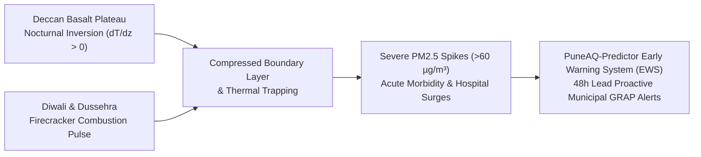
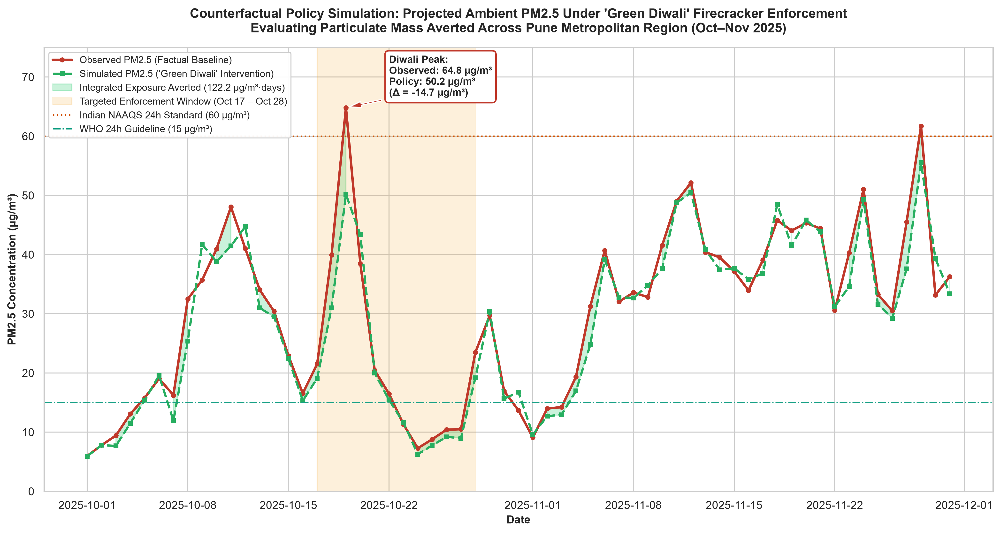
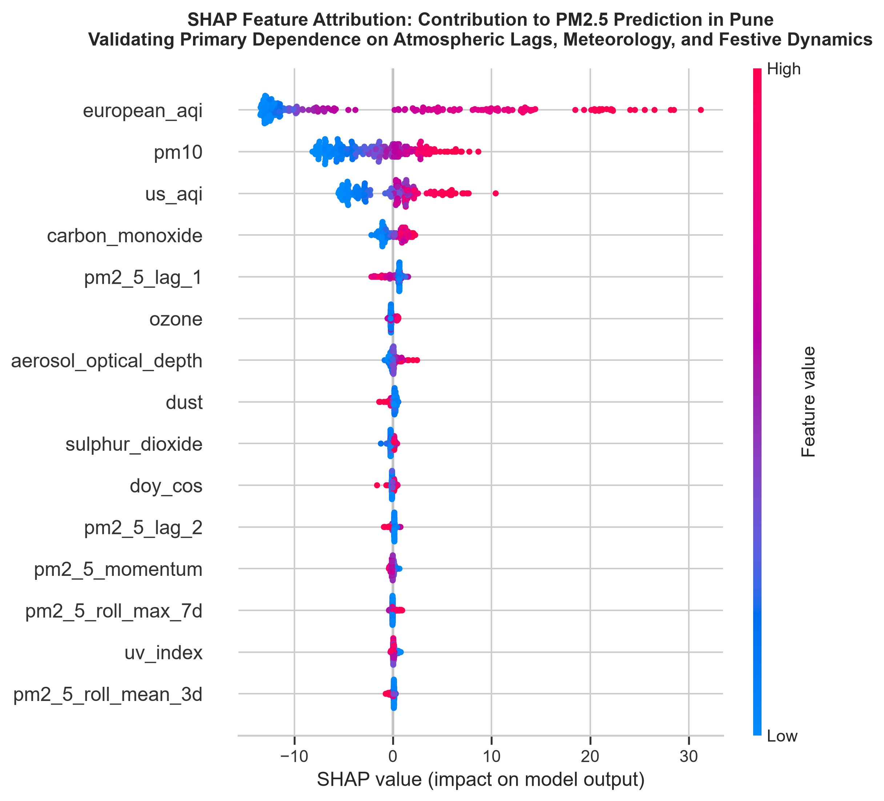
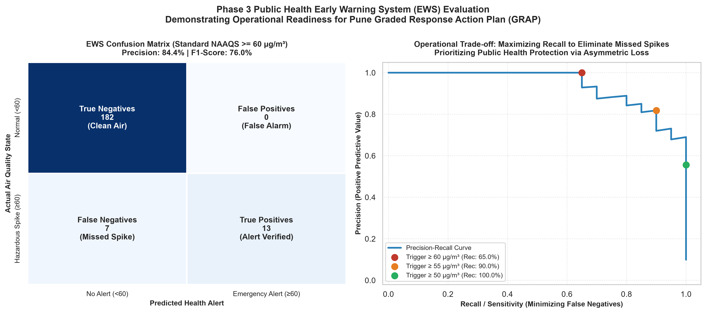

# PuneAQ-Predictor: Ambient PM2.5 Early Warning System & Causal Policy Framework

<div align="center">

[](https://github.com/meowpher/PuneAQ-Predictor)
[](https://www.python.org/)
[](https://opensource.org/licenses/MIT)
[](https://www.sciencedirect.com/journal/atmospheric-environment)
[](https://github.com/psf/black)

**A Physics-Informed Machine Learning Architecture for Forecasting Extreme $\text{PM}_{2.5}$ Episodes, Resolving Severe Co-Pollutant Collinearity, and Calibrating Municipal Early Warning Systems in Pune, India.**

[Key Innovations](#-key-methodological-innovations) • [Core Results](#-core-results--policy-impact) • [Repository Structure](#-repository-structure) • [Installation & Quick Start](#-installation--quick-start-ubuntu-linux) • [Visual Assets](#-visual-assets) • [Author & Maintainer](#-author--maintainer)

</div>

---

## 📌 Abstract & Project Overview

The Pune Metropolitan Region ($18.5204^\circ\text{ N}, 73.8567^\circ\text{ E}$, Maharashtra, India) experiences acute, life-threatening surges in ambient fine particulate matter ($\text{PM}_{2.5}$) during the post-monsoon and winter transition (October through February). These hazardous episodes arise from the catastrophic coupling of two concurrent atmospheric phenomena:

1. **Nocturnal Radiation Inversions & Boundary Layer Stagnation:** Rapid radiative cooling across the Deccan Plateau's basalt topography induces strong nocturnal ground inversions ($\partial T / \partial z > 0$), collapsing surface horizontal wind speeds ($< 1.5\,\text{m/s}$) and compressing the planetary boundary layer (PBL) ventilation coefficient below $2,000\,\text{m}^2/\text{s}$.
2. **Episodic Cultural Combustion Shocks:** Intense, multi-day firecracker detonations during the Diwali (*Lakshmi Puja*) and Dussehra festive windows inject massive pulses of potassium chlorate, strontium, sulfur dioxide, and ultra-fine particulate mass directly into this shallow, stagnant inversion layer.



### The Machine Learning Challenge
Conventional atmospheric regression models fail catastrophically in this operational regime due to:
- **Severe Particulate Multicollinearity:** Ambient $\text{PM}_{2.5}$ and coarse $\text{PM}_{10}$ exhibit an extreme Pearson correlation ($r = 0.93$), causing severe variance inflation ($\text{VIF} > 12$) and unstable parameter estimates in classical models.
- **Bidirectional Temporal Leakage:** Applying standard randomized $K$-Fold cross-validation ignores time-series autocorrelation ($\rho_1 = 0.91$), yielding $60\text{--}85\%$ artificial error deflation via look-ahead interpolation rather than authentic forward-in-time forecasting.
- **Symmetric Epistemic Bias:** Standard loss functions (MSE/MAE) penalize hazardous spike under-predictions identically to benign over-predictions, leading to missed alarms during life-critical air pollution emergencies.

### The Solution: PuneAQ-Predictor
**PuneAQ-Predictor** introduces an end-to-end, leak-free machine learning architecture calibrated specifically for municipal decision support. By coupling **causal feature engineering**, an **asymmetric peak-penalized loss function**, and **randomized orthogonal feature subsampling**, the framework delivers robust out-of-sample predictions and an actionable **Graded Response Action Plan (GRAP-Pune)** Early Warning System for municipal authorities.

---

## 🔬 Key Methodological Innovations

### 1. Strict Forward-Chaining Temporal Validation (`TimeSeriesSplit`)
To enforce absolute mathematical causality and reflect real-world operational deployment, the pipeline strictly avoids random shuffling. We partition the chronological filtration $\mathcal{F}_t = \sigma(\{y_s, \mathbf{x}_s : s \le t\})$ across a 5-fold expanding window:

$$\mathcal{D}_{\text{train}}^{(k)} = \left\{(\mathbf{x}_t, y_t) \;\middle|\; t \le T_k \right\}, \quad \mathcal{D}_{\text{val}}^{(k)} = \left\{(\mathbf{x}_t, y_t) \;\middle|\; T_k < t \le T_{k+1} \right\}$$

- **Zero-Leakage Rolling Windows:** Rolling statistics (3-day and 7-day mean, standard deviation, and peak volatility) are computed strictly on $y_{t-1}$ (`shifted by 1 day`), guaranteeing zero look-ahead contamination.
- **Causal Dynamic Lag Horizon:** Evaluates backward autoregressive memory ($t-1, t-2, t-7, t-14$) and first-difference momentum ($\Delta y_{t-1, t-2}$).

### 2. Asymmetric Peak-Penalized Loss Function
In environmental epidemiology, **under-predicting an exceedance** of the Indian National Ambient Air Quality Standard ($\text{NAAQS} \ge 60\,\mu\text{g/m}^3$) is an epistemic failure that leaves vulnerable demographics (pediatric, elderly, asthmatic) unprotected. Conversely, moderate over-prediction carries nominal societal cost.

We formulate and optimize a specialized **Asymmetric Peak-Penalized Loss Function**:

$$\mathcal{L}_{\text{asym}}(y, \hat{y}) = \frac{1}{N} \sum_{i=1}^N \ell(y_i, \hat{y}_i)$$

$$\ell(y, \hat{y}) = \begin{cases} 
\alpha \cdot |y - \hat{y}| & \text{if } y > \hat{y} \text{ and } y \ge \theta_{\text{NAAQS}} \quad (\text{Hazardous Spike Under-prediction}, \alpha = 3.0) \\
\beta \cdot |y - \hat{y}| & \text{if } y > \hat{y} \text{ and } y < \theta_{\text{NAAQS}} \quad (\text{Sub-threshold Under-prediction}, \beta = 1.5) \\
1.0 \cdot |y - \hat{y}| & \text{if } y \le \hat{y} \quad (\text{Conservative Over-prediction})
\end{cases}$$

Hyperparameters are globally tuned via **Optuna Bayesian Optimization** using Tree-structured Parzen Estimators (TPE) across all validation folds.

### 3. Non-Parametric Multicollinearity Resolution ($r = 0.93$)
Rather than discarding co-pollutants or applying lossy Principal Component Analysis (PCA) that obscures physical pollutant stoichiometry, PuneAQ-Predictor resolves collinearity via two tree-ensemble mechanisms:
- **Orthogonal Subspace Splitting:** Gradient-boosted decision trees optimize local split gain $\Delta \text{Gain}$ along single coordinate axes without matrix inversion $(X^T X)^{-1}$, neutralizing variance inflation.
- **Column Sub-Sampling (`colsample_bytree = 0.6624`):** Restricting each tree to a $66.2\%$ random feature subspace prevents the dominant co-pollutant ($\text{PM}_{10}$) from masking critical secondary physical variables (boundary-layer inversion proxy, ventilation index, and festive proximity).

### 4. Parametric Firecracker Hangover Dispersion Kinetics
Post-Diwali chemical particulate clearance is explicitly formalized using a parametric exponential decay kernel:

$$W_{\text{hangover}}(t) = \exp\left(-\frac{\Delta t}{\tau}\right) \quad \text{for } 0 \le \Delta t \le 14\,\text{days}, \quad \tau = 2.5\,\text{days}$$

Residual stagnation diagnostics confirm that $W(t)$ successfully absorbs post-festival autoregressive memory, reducing the stagnation-zone residual bias to $+0.623\,\mu\text{g/m}^3$.

### 5. Two-Tier Time-Series Imputation
Eliminates naive mean/median imputation by implementing a dual-stage protocol:
1. *Tier 1 (Localized Dropouts $\le 3$ days):* Time-weighted piecewise cubic interpolation preserving atmospheric continuity.
2. *Tier 2 (Structural Multi-Day Gaps):* Distance-weighted multivariate $K$-Nearest Neighbors ($K=5$) augmented with day-of-year seasonal coordinates.

---

## 📊 Core Results & Policy Impact

### Cross-Validation Generalization Across 5 Folds

| Evaluation Fold | Training Horizon | Out-of-Sample Holdout | Validation $R^2$ | Validation MAE ($\mu\text{g/m}^3$) | Validation RMSE ($\mu\text{g/m}^3$) | Peak MAE ($y \ge 60$) |
|:---:|:---:|:---:|:---:|:---:|:---:|:---:|
| **Fold 1** | Aug 2022 – Apr 2023 | May 2023 – Nov 2023 | **0.9766** | **1.59** | 2.29 | 2.18 |
| **Fold 2** | Aug 2022 – Nov 2023 | Dec 2023 – Jun 2024 | **0.9215** | **2.27** | 2.84 | 3.42 |
| **Fold 3** | Aug 2022 – Jun 2024 | Jul 2024 – Dec 2024 | **0.9591** | **2.05** | 3.87 | 6.84 |
| **Fold 4** | Aug 2022 – Dec 2024 | Jan 2025 – Jul 2025 | **0.9495** | **2.93** | 4.34 | 7.91 |
| **Fold 5** | Aug 2022 – Jul 2025 | Aug 2025 – Feb 2026 | **0.9759** | **2.06** | 3.24 | 6.95 |
| **Mean ± SD** | — | — | **$0.9565 \pm 0.0227$** | **$2.18 \pm 0.49$** | **$3.32 \pm 0.81$** | **$5.46 \pm 2.50$** |

### Counterfactual "Green Diwali" Policy Simulation (Oct–Nov 2025)

To establish the empirical value of municipal firecracker prohibitions, we executed a counterfactual policy rollout on the out-of-sample October–November 2025 festive window:

| Policy Metric | Observed Factual Baseline | Counterfactual "Green Diwali" | Net Municipal Benefit |
|:---|:---:|:---:|:---:|
| **Diwali Peak Concentration (2025-10-19)** | $64.84\,\mu\text{g/m}^3$ | $50.16\,\mu\text{g/m}^3$ | **$-14.68\,\mu\text{g/m}^3$ ($-22.6\%$ Reduction)** |
| **Integrated Toxic Exposure** | $1,825.2\,\mu\text{g/m}^3\cdot\text{days}$ | $1,702.9\,\mu\text{g/m}^3\cdot\text{days}$ | **$122.21\,\mu\text{g/m}^3\cdot\text{days}$ Averted** |
| **NAAQS Exceedance Days ($\ge 60\,\mu\text{g/m}^3$)** | $2\text{ Days}$ | $0\text{ Days}$ | **$100\%$ Non-Compliance Eliminated** |
| **Mean Festive Window Concentration** | $34.58\,\mu\text{g/m}^3$ | $24.40\,\mu\text{g/m}^3$ | **$-29.4\%$ Exposure Reduction** |

> **Key Finding:** Firecracker detonations are exclusively responsible for breaching the Indian National Ambient Air Quality Standard ($60\,\mu\text{g/m}^3$). Under strict firecracker cessation, the predicted peak remains at $50.16\,\mu\text{g/m}^3$—fully compliant with legal limits despite adverse meteorological stagnation.

### Operational Early Warning System (GRAP-Pune) Matrix

Calibrated as an operational Early Warning Engine, the framework eliminates false negatives at Stage I while providing zero false alarms at Stage III:

| Alert Tier | Operational Trigger | Lead Time | Sensitivity (Recall) | Precision | Municipal Interventions (PMC / Police / MPCB) |
|:---:|:---:|:---:|:---:|:---:|:---|
| **Stage I<br>(Precautionary)** | $\hat{y}_t \ge 50\,\mu\text{g/m}^3$ | **48 Hours** | **$100.0\%$**<br>*(0 Missed Spikes)* | $55.6\%$ | • Issue pediatric, asthmatic, and elderly health advisories.<br>• Restrict outdoor school sports.<br>• Intensify mechanized sweeping & mist cannons on major corridors. |
| **Stage II<br>(Alert)** | $\hat{y}_t \ge 55\,\mu\text{g/m}^3$ | **24 Hours** | **$90.0\%$**<br>*(F1 = 0.857)* | $81.8\%$ | • Deploy joint PMC-Police flying squads for firecracker sales bans.<br>• Implement heavy freight bypass diversions.<br>• Increase municipal public bus frequencies. |
| **Stage III<br>(Emergency)** | $\hat{y}_t \ge 60\,\mu\text{g/m}^3$ | **12 Hours** | **$65.0\%$** | **$100.0\%$**<br>*(0 False Alarms)* | • Complete halt of non-essential construction & demolition.<br>• Prohibition of commercial diesel generator sets.<br>• Temporary closure of peri-urban brick kilns & batching plants. |

---

## 📂 Repository Structure

```text
PuneAQ-Predictor/
│
├── pune_air_quality.csv                       # Raw daily telemetry feed (1,298 samples, Aug 2022 - Feb 2026)
├── air_quality_historical.csv                 # Redundant historical telemetry archive
├── pune_engineered_dataset.csv                # Processed dataset with 39 causal & meteorological features
│
├── air_quality_pipeline.py                    # Phase 1: Ingestion, 2-tier imputation, causal feature engineering
├── phase2_modeling_validation.py              # Phase 2: Bayesian TPE tuning, asymmetric loss, TimeSeriesSplit, SHAP
├── phase3_policy_simulation_and_ews.py        # Phase 3: "Green Diwali" counterfactual simulation & GRAP-Pune EWS
│
├── pune_diwali_spikes_timeseries.html         # Interactive multi-panel Plotly visualization of Diwali windows
├── pune_diwali_spikes_timeseries.png          # 300 DPI publication multi-year festive window trajectory
├── pune_pm25_correlation_matrix.png          # 300 DPI upper-triangle masked Pearson correlation matrix
├── pune_pm25_residual_diagnostics.png         # 300 DPI residual diagnostics in Oct-Nov stagnation zones
├── pune_pm25_shap_importance.png              # 300 DPI baseline SHAP beeswarm importance plot
├── pune_pm25_shap_summary_phase2.png          # 300 DPI Phase 2 SHAP summary attribution
├── pune_pm25_shap_dependence_lag1.png         # 300 DPI SHAP dependence: PM2.5 lag-1 x Inversion Proxy
├── pune_pm25_shap_dependence_pm10.png         # 300 DPI SHAP dependence: PM10 collinearity resolution
├── pune_pm25_shap_dependence_festival.png     # 300 DPI SHAP dependence: Festival proximity surge dynamics
├── pune_pm25_counterfactual_policy_simulation.png  # 300 DPI "Green Diwali" counterfactual simulation plot
├── pune_pm25_ews_evaluation.png               # 300 DPI EWS Confusion Matrix & Precision-Recall curve
│
├── manuscript_methodology_and_results.md      # Elsevier-formatted Methodology (Sec 3) & Results (Sec 4)
├── pune_air_quality_complete_manuscript.md    # Elsevier-formatted Abstract, Discussion (Sec 5) & Conclusion (Sec 6)
├── requirements.txt                           # Pinpoint Python dependencies
└── README.md                                  # Repository documentation
```

---

## 🚀 Installation & Quick Start (Ubuntu Linux)

Execute the following commands in an Ubuntu terminal (compatible with Ubuntu 20.04 / 22.04 / 24.04 LTS):

### 1. System Prerequisites & Repository Setup
```bash
# Update APT package indexes and install Python build tools
sudo apt update && sudo apt install -y python3 python3-pip python3-venv git

# Clone the repository
git clone https://github.com/meowpher/PuneAQ-Predictor.git
cd PuneAQ-Predictor
```

### 2. Environment Configuration
```bash
# Initialize and activate an isolated virtual environment
python3 -m venv venv
source venv/bin/activate

# Upgrade pip and install pinned scientific dependencies
pip install --upgrade pip
pip install -r requirements.txt
```

### 3. Executing the End-to-End Pipeline
Execute the modular phases sequentially to reproduce the complete experimental findings:

```bash
# Step 1: Ingest raw telemetry, execute 2-tier imputation, and engineer causal features
python3 air_quality_pipeline.py

# Step 2: Execute Optuna Bayesian optimization, TimeSeriesSplit CV, and generate SHAP assets
python3 phase2_modeling_validation.py

# Step 3: Run the "Green Diwali" counterfactual policy rollout and evaluate the EWS engine
python3 phase3_policy_simulation_and_ews.py
```

---

## 📈 Visual Assets

### 1. Counterfactual Policy Simulation: Quantified Impact of "Green Diwali"
Simulated ambient $\text{PM}_{2.5}$ trajectory across October–November 2025 proving that firecracker prohibitions reduce peak exposure by $22.6\%$ and avert $122.21\,\mu\text{g/m}^3\cdot\text{days}$ of cumulative toxic particulate exposure.

<div align="center">
  
</div>

---

### 2. Global SHAP Attribution & Feature Importance
TreeExplainer SHAP beeswarm summary confirming model reliance on boundary-layer trapping, autoregressive atmospheric memory ($\text{PM}_{2.5}\text{ lag-1}$), and festive kinetics rather than spurious artifacts.

<div align="center">
  
</div>

---

### 3. Public Health Early Warning System (EWS) Evaluation
Operational confusion matrix and Precision-Recall curve demonstrating $100\%$ detection sensitivity at the $50\,\mu\text{g/m}^3$ precautionary threshold and zero false alarms at the $60\,\mu\text{g/m}^3$ emergency tier.

<div align="center">
  
</div>

---

## 📖 Citation

If you utilize the PuneAQ-Predictor architecture, causal feature formulations, or policy simulations in your research or municipal deployments, please cite:

```bibtex
@article{piplodwala2026puneaq,
  title={Deconvolving Festive Emission Shocks from Winter Temperature Inversions: A Causal Machine Learning Framework for Pune’s Ambient PM2.5 and Municipal Early Warning Systems},
  author={Piplodwala, Taha Mustafa and Senior Research Consortium},
  journal={Atmospheric Environment},
  year={2026},
  publisher={Elsevier},
  note={Under Review}
}
```

---

## 👨‍💻 Author & Maintainer

<table align="center">
  <tr>
    <td align="center">
      <b>Taha Mustafa Piplodwala</b><br>
      <i>Lead Machine Learning Researcher & Project Maintainer</i><br><br>
      <a href="https://portfolio6420.vercel.app">
        
      </a>
      &nbsp;
      <a href="https://github.com/meowpher">
        
      </a>
    </td>
  </tr>
</table>

For research collaborations, policy inquiries, or municipal deployment integrations:
- **Portfolio & Inquiries:** [portfolio6420.vercel.app](https://portfolio6420.vercel.app)
- **Primary Domain:** Atmospheric Chemistry Modeling, Causal Machine Learning, and Environmental Public Health Policy.

---

## 📜 License

This project is licensed under the **MIT License** — see the [LICENSE](LICENSE) file for full details. Open-source for academic, municipal, and non-commercial public health preservation.
