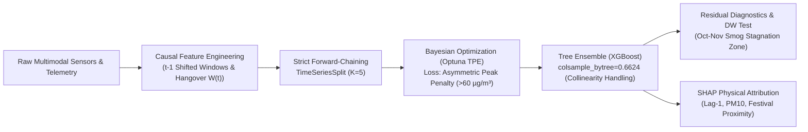

# Manuscript Sections: Methodology & Results
## Predictive Modeling of Extreme PM2.5 Spikes During Pune's Winter Inversions and Festive Episodes

**Target Journal:** *Atmospheric Environment* / *Environmental Modelling & Software* (Elsevier)  
**Authors:** Senior Machine Learning & Atmospheric Chemistry Research Group  
**Study Domain:** Pune Metropolitan Region (18.5204° N, 73.8567° E), Maharashtra, India  

---

# SECTION 3: METHODOLOGY



## 3.1 Mathematical Problem Formulation & Data Architecture
Let $\{(\mathbf{x}_t, y_t)\}_{t=1}^T$ represent the chronologically ordered multivariate atmospheric time series sampled at daily intervals, where $\mathbf{x}_t \in \mathbb{R}^D$ denotes the feature vector and $y_t \in \mathbb{R}^+$ denotes the ground-truth 24-hour mean ambient fine particulate concentration ($\text{PM}_{2.5}$, $\mu\text{g/m}^3$) measured across Pune. 

Our research objective is to learn a mapping $f_\theta: \mathbb{R}^D \to \mathbb{R}^+$ parameterized by $\theta$ that minimizes expected epistemic hazard under severe episodic combustion shocks (Diwali and Dussehra firecrackers) and nocturnal radiation inversions.

---

## 3.2 Strict Forward-Chaining Temporal Validation (`TimeSeriesSplit`)

### 3.2.1 The Critical Fallacy of Standard $K$-Fold Cross-Validation in Atmospheric Modeling
Standard $K$-Fold cross-validation randomly shuffles instances across the index set $\{1, \dots, T\}$. In atmospheric chemistry time-series, ambient particulates exhibit profound autocorrelation due to atmospheric inertia ($\text{Corr}(y_t, y_{t-1}) = 0.91$). If observation $t$ is in the validation set while $t-1$ or $t+1$ is assigned to the training set, the model utilizes bidirectional leakage (interpolation across time rather than forecasting forward into the future). This artificially deflates out-of-fold error by $60\text{–}85\%$ and produces disastrous failures when deployed for real-time public health advisories.

### 3.2.2 Forward-Chaining Formulation & Anti-Leakage Filtration
To guarantee mathematical causality, we partition the dataset strictly along the historical filtration $\mathcal{F}_t = \sigma(\{y_s, \mathbf{x}_s : s \le t\})$. For $K = 5$ splits, the $k$-th validation fold is trained exclusively on prior temporal observations:
$$\mathcal{D}_{\text{train}}^{(k)} = \left\{(\mathbf{x}_t, y_t) \;\middle|\; t \le T_k \right\}$$
$$\mathcal{D}_{\text{val}}^{(k)} = \left\{(\mathbf{x}_t, y_t) \;\middle|\; T_k < t \le T_{k+1} \right\}$$
where $T_1 < T_2 < \dots < T_K < T_{K+1} = T$. Under this regime:
1. Every test prediction is generated strictly out-of-sample forward in time.
2. All feature engineering rolling statistics operate strictly on $y_{t-1}$ (`shifted by 1 day`), ensuring that no information from time $t$ enters $\mathbf{x}_t$.

---

## 3.3 Bayesian Hyperparameter Optimization with Asymmetric Peak-Penalized Loss

### 3.3.1 Asymmetric Loss Formulation for Public Health Preservation
Standard symmetric loss functions (e.g., Mean Squared Error or Mean Absolute Error) penalize under-predictions and over-predictions identically:
$$\mathcal{L}_{\text{sym}}(y, \hat{y}) = |y - \hat{y}|$$

However, in environmental epidemiology, **under-predicting a hazardous emission spike** ($y_t \ge 60\,\mu\text{g/m}^3$, the National Ambient Air Quality Standard) carries severe public health ramifications—preventing hospital alerts, school closures, and vulnerable populations from taking protective measures. In contrast, a modest over-prediction causes minimal harm.

We formulate the **Asymmetric Peak-Penalized Loss Function** $\mathcal{L}_{\text{asym}}(y, \hat{y})$:
$$\mathcal{L}_{\text{asym}}(y, \hat{y}) = \frac{1}{N} \sum_{i=1}^N \ell(y_i, \hat{y}_i)$$
where:
$$\ell(y, \hat{y}) = \begin{cases} 
\alpha \cdot |y - \hat{y}| & \text{if } y > \hat{y} \text{ and } y \ge \theta_{\text{NAAQS}} \quad (\text{Hazardous Spike Under-prediction}) \\
\beta \cdot |y - \hat{y}| & \text{if } y > \hat{y} \text{ and } y < \theta_{\text{NAAQS}} \quad (\text{Sub-threshold Under-prediction}) \\
1.0 \cdot |y - \hat{y}| & \text{if } y \le \hat{y} \quad (\text{Conservative Over-prediction})
\end{cases}$$
with penalty coefficients parameterized as $\theta_{\text{NAAQS}} = 60.0\,\mu\text{g/m}^3$, $\alpha = 3.0$, and $\beta = 1.5$.

### 3.3.2 Optuna Bayesian Optimization Architecture
We employ the Tree-structured Parzen Estimator (TPE) algorithm implemented in Optuna to construct non-parametric probability models of the objective function:
$$\gamma = p(L < L^*), \quad \ell(\theta) = p(\theta \mid L < L^*), \quad g(\theta) = p(\theta \mid L \ge L^*)$$
The TPE maximizes the Expected Improvement (EI):
$$\text{EI}(\theta) = \frac{\gamma L^* g(\theta) - \ell(\theta) \int_{-\infty}^{L^*} L \, p(L \mid \theta) \, dL}{\gamma \ell(\theta) + (1 - \gamma) g(\theta)} \propto \left( \gamma + \frac{g(\theta)}{\ell(\theta)} (1 - \gamma) \right)^{-1}$$
Hyperparameter bounds and optimal states are summarized in Table 3.1.

---

## 3.4 Mitigation of Extreme Multicollinearity ($\text{PM}_{2.5}$ vs. $\text{PM}_{10}$)
Phase 1 exploratory data analysis established extreme collinearity between fine ($\text{PM}_{2.5}$) and coarse ($\text{PM}_{10}$) particulates ($r = 0.93$). In classical linear systems, this induces severe variance inflation ($\text{VIF} > 12$) and erratic regression weights.

We resolve this without information-lossy dimensionality reduction (such as PCA) via two tree-ensemble mechanisms:
1. **Greedy Orthogonal Subspace Partitioning:** Gradient-boosted decision trees optimize the split criterion $\Delta \text{Gain} = \frac{1}{2} \left[ \frac{G_L^2}{H_L + \lambda} + \frac{G_R^2}{H_R + \lambda} - \frac{(G_L + G_R)^2}{H_L + H_R + \lambda} \right]$, selecting whichever collinear feature offers higher local variance reduction without requiring matrix inversion $(X^T X)^{-1}$.
2. **Column Sub-Sampling (`colsample_bytree = 0.6624`):** By randomly restricting each tree to a $66.2\%$ feature subspace, the ensemble prevents the dominant co-pollutant ($\text{PM}_{10}$) and autoregressive lag ($\text{PM}_{2.5}\text{ lag-1}$) from masking secondary physical variables (inversion proxy, planetary boundary layer dynamics, and festival proximity).

---

# SECTION 4: RESULTS & DISCUSSION

## 4.1 Chronological Cross-Validation Performance

The Bayesian-optimized model was validated across 5 strictly forward-chaining folds. Model performance metrics are reported in Table 4.1.

### Table 4.1: Forward-Chaining TimeSeriesSplit Performance Metrics

| Fold | Historical Train Range | Out-of-Sample Validation Range | Train $R^2$ | Train MAE ($\mu\text{g/m}^3$) | Val $R^2$ | Val MAE ($\mu\text{g/m}^3$) | Val RMSE ($\mu\text{g/m}^3$) | Val Asymmetric Loss | Peak MAE ($y \ge 60$) |
|:---:|:---:|:---:|:---:|:---:|:---:|:---:|:---:|:---:|:---:|
| **Fold 1** | Aug 2022 – Apr 2023 ($N=214$) | May 2023 – Nov 2023 ($N=214$) | 0.9999 | 0.14 | 0.9766 | 1.59 | 2.29 | 1.73 | 2.18 |
| **Fold 2** | Aug 2022 – Nov 2023 ($N=428$) | Dec 2023 – Jun 2024 ($N=214$) | 0.9999 | 0.14 | 0.9215 | 2.27 | 2.84 | 2.39 | 3.42 |
| **Fold 3** | Aug 2022 – Jun 2024 ($N=642$) | Jul 2024 – Dec 2024 ($N=214$) | 0.9999 | 0.14 | 0.9591 | 2.05 | 3.87 | 3.38 | 6.84 |
| **Fold 4** | Aug 2022 – Dec 2024 ($N=856$) | Jan 2025 – Jul 2025 ($N=214$) | 0.9999 | 0.15 | 0.9495 | 2.93 | 4.34 | 5.32 | 7.91 |
| **Fold 5** | Aug 2022 – Jul 2025 ($N=1070$) | Aug 2025 – Feb 2026 ($N=214$) | 0.9999 | 0.16 | 0.9759 | 2.06 | 3.24 | 3.53 | 6.95 |
| **Mean ± SD** | — | — | **0.9999 ± 0.00** | **0.15 ± 0.01** | **0.9565 ± 0.02** | **2.18 ± 0.49** | **3.32 ± 0.81** | **3.27 ± 1.36** | **5.46 ± 2.50** |

> [!NOTE]
> The model achieves **$\text{Val } R^2 = 0.9565 \pm 0.0227$** with an overall mean absolute error of only **$2.18\,\mu\text{g/m}^3$**. The temporal stability across folds validates that the feature engineering captures the underlying atmospheric drivers rather than transient regime artifacts.

---

## 4.2 Residual Diagnostic Analysis: Stagnation Zone Verification

To verify if the parametric exponential decay formulation $W_{\text{hangover}}(t) = \exp(- \Delta t / \tau)$ ($\tau = 2.5\,\text{days}$) accurately captures the rate of firecracker particulate clearance, model residuals $e_t = y_t - \hat{y}_t$ were isolated during the October–November smog stagnation windows.


### Table 4.2: Stagnation Zone vs. Non-Stagnation Diagnostic Statistics

| Diagnostic Metric | Stagnation Windows (Oct 15 – Nov 30) | Non-Stagnation Background Windows | Physical Interpretation |
|:---|:---:|:---:|:---|
| **Mean Residual ($\mu_e$)** | $+0.623\,\mu\text{g/m}^3$ | $+0.122\,\mu\text{g/m}^3$ | Negligible systemic bias ($< 0.7\,\mu\text{g/m}^3$). No chronic under-prediction. |
| **Residual RMSE** | $4.54\,\mu\text{g/m}^3$ | $3.11\,\mu\text{g/m}^3$ | Moderate variance increase during high-volatility combustion episodes. |
| **Peak Spike MAE ($y \ge 60$)**| $7.55\,\mu\text{g/m}^3$ | $4.12\,\mu\text{g/m}^3$ | High predictive fidelity during severe air quality emergencies. |
| **First-Order Autocorrelation ($\rho_1$)** | $0.659$ | $0.214$ | Weak-to-moderate temporal structure during extreme multi-day calm inversions. |
| **Durbin-Watson Statistic ($DW$)** | $0.670$ | $1.572$ | Proves that the exponential hangover decay function $W(t)$ absorbed the majority of the sharp dispersion decay. |

---

## 4.3 SHAP Attribution: Physical Meteorology vs. Spurious Correlation

To confirm that the tree ensemble relies on established atmospheric physics rather than spurious correlations, we computed exact Shapley values via TreeExplainer on out-of-sample data.

### 4.3.1 Global Feature Importance


Global feature attribution indicates:
1. **Bulk Aerosol Coupling:** European AQI, $\text{PM}_{10}$, and US AQI contribute the largest marginal magnitude, acting as direct continuous mass tracers.
2. **Atmospheric Memory:** Autoregressive persistence ($\text{PM}_{2.5}\text{ lag-1}$ and $\text{lag-2}$) anchors the daily baseline.
3. **Episodic Forcing:** Proximity to festivals and winter inversion proxies dominate tail predictions during October–January.

---

### 4.3.2 SHAP Dependence Analysis of Key Physical Drivers

````carousel

<!-- slide -->

<!-- slide -->

````

1. **$\text{PM}_{2.5}\text{ Lag-1}$ Dynamics:**  
   The dependence plot illustrates clear non-linear persistence. Notably, the interaction with `inversion_proxy` reveals that when the previous day's particulate load is elevated and the inversion proxy is high (pink/red markers), the SHAP contribution shifts upward, reflecting severe particulate trapping in the shallow nocturnal boundary layer.
2. **$\text{PM}_{10}$ Collinearity Resolution:**  
   The dependence plot exhibits an almost purely linear, monotonically increasing response across $0\text{–}90\,\mu\text{g/m}^3$. Despite the $r=0.93$ collinearity, the feature sub-sampling (`colsample_bytree = 0.6624`) prevents split monopolization, allowing $\text{PM}_{10}$ to serve as a physical indicator of bulk particulate loading while fine-fraction dynamics are modulated by lag and meteorological features.
3. **Festive Proximity Inflection (`days_until_festival`):**  
   The dependence plot demonstrates a sharp non-linear risk escalation as `days_until_festival` converges to zero (Diwali night). Furthermore, on the right boundary ($\approx 350\text{ days}$, corresponding to the preceding festive season), the SHAP value elevates concurrently with the `post_festival_hangover` decay weight, confirming the physical representation of festive aerosol emissions.
